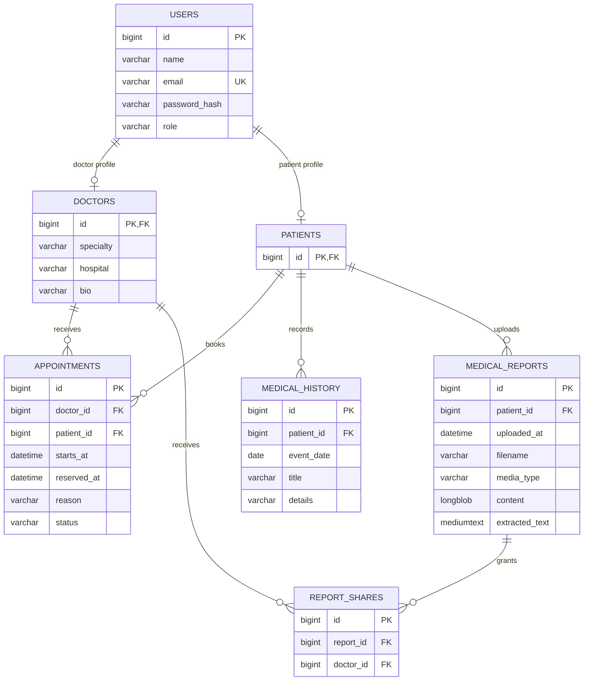

# CareBridge database ER diagram

- A user has exactly one profile through the registration workflow. The profile shares the user ID.
- The clinic and all appointments use India Standard Time. `starts_at` records the original visit time. `reserved_at` is the same value until cancellation, when MySQL allows the old record to keep a NULL reservation.
- Separate unique constraints on `(doctor_id, reserved_at)` and `(patient_id, reserved_at)` arbitrate simultaneous bookings.
- The unique `(report_id, doctor_id)` pair represents explicit sharing. It remains valid until the patient revokes it or deletes the report. Cancellation alone leaves sharing in place.
- Flyway owns the schema. See [V1__carebridge.sql](../backend/src/main/resources/db/migration/V1__carebridge.sql).
